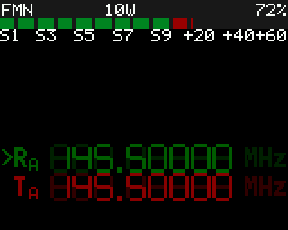

# OpenGD77_DK1DA-Mod

**OpenGD77_DK1DA-Mod is a fork of the [OpenGD77](https://opengd77.org) firmware** for DMR
transceivers built around the STM32F405VGT MCU, AT1846S RF chip and HR-C6000 DMR
chipset — the **TYT MD-UV380 / Retevis RT-3S** and **Baofeng DM-1701 / Retevis
RT-84**.

It adds a number of UI and quality-of-life changes on top of OpenGD77 (segmented
S-meter, 7-segment frequency font, screen dimming, an audio-mute function, menu
icons, and more). See [`CHANGELOG.md`](CHANGELOG.md) for the full list.

## Screenshots

| Segmented S-meter & DMR call | 7-segment frequency display |
| --- | --- |
|  |  |

## Supported radios

This first iteration is developed for and **tested only on the TYT MD-UV380 and
Retevis RT-3S**. No other radios are officially supported at this time.

If you have another radio that OpenGD77 supports (Baofeng DM-1701 / Retevis RT-84,
MD-9600, MD-380, MD-2017, …) and would like to help test OpenGD77_DK1DA-Mod on it, that would
be very welcome — please email **Marcus, DK1DA** at <marcus.kida@bearologics.com>.

## Upstream source

This fork is based on the official OpenGD77 source release **R20260131**
(source snapshot `OpenGD77_MDUV380_DM1701_20260130`):

<https://opengd77.eu/index.php?dir=MDUV380_DM1701_RT3S_RT84/R20260131/sources_and_tools/&file=OpenGD77_MDUV380_DM1701_20260130.zip>

The original OpenGD77 project README is preserved in
[`README.OpenGD77.md`](README.OpenGD77.md).

## DMR / AMBE codec

As with OpenGD77, the source does **not** contain the AMBE codec required for DMR
audio. It is merged in from an official manufacturer firmware (V26.45) at flash
time by the firmware loader. See [`TOOLS.md`](TOOLS.md).

## Building, flashing & tools

See [`TOOLS.md`](TOOLS.md) for building (Docker + Arm GNU Toolchain 14), flashing
(`./flash.sh`), grabbing screenshots, and building language files.

## License

OpenGD77_DK1DA-Mod **inherits the OpenGD77 license** — a modified BSD 3-Clause license with
an additional **non-commercial** clause. It is **not** an OSI-approved
open-source license and is **not GPL-compatible**; commercial use is prohibited.
The code cannot be relicensed. See [`LICENSE.md`](LICENSE.md).

## Credits

OpenGD77 was originally conceived by **Kai Ludwig, DG4KLU**, with further
development led by **Roger Clark, VK3KYY** and assisted by **Daniel
Caujolle-Bert, F1RMB**, Alex DL4LEX, Colin G4EML and many other contributors.
All original copyrights are retained (see the source file headers and
[`README.OpenGD77.md`](README.OpenGD77.md)).

OpenGD77_DK1DA-Mod fork maintained by **Marcus, DK1DA**.
