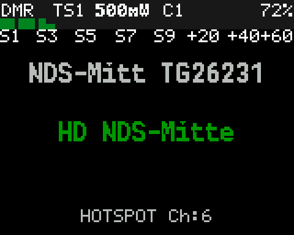

# OpenGD77_DK1DA-Mod

**OpenGD77_DK1DA-Mod is a fork of the [OpenGD77](https://opengd77.org) firmware** for DMR
transceivers built around the STM32F405VGT MCU, AT1846S RF chip and HR-C6000 DMR
chipset — the **TYT MD-UV380 / Retevis RT-3S** and **Baofeng DM-1701 / Retevis
RT-84**.

It adds a number of UI and quality-of-life changes on top of OpenGD77 (segmented
S-meter, 7-segment frequency font, screen dimming, an audio-mute function, menu
icons, on-radio channel editing, and more).

📖 **[`MANUAL.md`](MANUAL.md)** is the full feature & usage guide — every feature is
tagged 🟢 **[OpenGD77_DK1DA-Mod]** (new/changed here) or ⚪ **[OpenGD77]** (inherited). See
[`CHANGELOG.md`](CHANGELOG.md) for the version history.

## Screenshots

| Segmented S-meter & DMR call | 7-segment frequency display |
| --- | --- |
|  |  |

## What's different from OpenGD77

OpenGD77_DK1DA-Mod keeps OpenGD77's core (DMR/FM, hotspot, CPS compatibility) and adds:

- **Audio mute — new SK2 short-tap.** A short tap of **SK2** on the VFO/Channel
  screen toggles the speaker mute on and off. Turning the **volume knob fully
  down** counts as muted too. While muted, a bold **"M"** appears in the status
  bar (left of the battery) and the **red LED flashes** (0.5 s every 2 s). SK2's
  existing roles are unchanged: held as a modifier, extra-long-press for
  monitor/squelch-off, and — while a DMR QSO is on screen — a tap still sets the
  TX talkgroup to the incoming one.
- **Segmented block S-meter** with one block per S-level (S1–S9 green, S9+ red)
  and a scale label row (S1 S3 S5 S7 S9 / +20 +40 +60).
- **7-segment "LED" frequency font** on the VFO and the SK1-held frequency view.
- **Screen dimming** — optionally dim the backlight to 100 / 50 / 30 / 15 % after
  inactivity (Auto backlight mode); new setting in Display Options.
- **On-radio channel management** — create and delete channels directly from the
  Channel quick menu, no PC/CPS required (see [Managing channels](#managing-channels-on-the-radio)).
- **Main-menu icons** next to each top-level entry.
- **DMR reliability fix** — resolves a hard-fault (freeze needing a battery pull)
  on the DMR path that affected recent self-built OpenGD77 revisions.

See [`CHANGELOG.md`](CHANGELOG.md) for the complete list.

## Managing channels on the radio

OpenGD77_DK1DA-Mod can create and delete channels without a PC. Both actions live in the
**Channel quick menu** — from the Channel screen, press the **top (orange)
button** to open it, then scroll to the bottom:

- **New channel** — creates a blank **145.500 MHz FM** channel in the first free
  slot, adds it to the current zone, and opens **Channel Details** so you can set
  the name, frequency, tones, and so on. Press the **green** key to save. The new
  channel is immediately selectable in the zone (no need to re-enter it).
- **Delete Channel** — deletes the currently-selected channel after a
  confirmation (**green** confirms, **red** cancels). It is also scrubbed from
  every zone that referenced it. The last remaining channel cannot be deleted,
  and channels locked read-only (e.g. APRS) are protected.

> **Back up your codeplug** (via the CPS) before making bulk edits — these changes
> are written straight to the radio and there is no on-device undo.

## Supported radios

This first iteration is developed for and **tested only on the TYT MD-UV380 and
Retevis RT-3S**. No other radios are officially supported at this time.

If you have another radio that OpenGD77 supports (Baofeng DM-1701 / Retevis RT-84,
MD-9600, MD-380, MD-2017, …) and would like to help test OpenGD77_DK1DA-Mod on it, that would
be very welcome — please email **Marcus, DK1DA** at <qsl@dk1da.de>.

## Upstream source

This fork is based on the official OpenGD77 source release **R20260131**
(source snapshot `OpenGD77_MDUV380_DM1701_20260130`):

<https://opengd77.eu/index.php?dir=MDUV380_DM1701_RT3S_RT84/R20260131/sources_and_tools/&file=OpenGD77_MDUV380_DM1701_20260130.zip>

The original OpenGD77 project README is preserved in
[`README.OpenGD77.md`](README.OpenGD77.md).

## DMR / AMBE codec

As with OpenGD77, the source does **not** contain the AMBE codec required for DMR
audio. It is merged in from an official manufacturer firmware (V26.45) at flash
time by the firmware loader. See [`TOOLS.md`](TOOLS.md).

## Flashing

Pre-built firmware is attached to each
[release](https://git.dk1da.de/DK1DA/OpenGD77_DK1DA-Mod/releases): `OpenMDUV380.bin` for the
MD-UV380 / RT-3S, `OpenDM1701.bin` for the DM-1701 / RT-84. (Or build your own —
see below.)

1. **Enter firmware-update (DFU) mode:** power the radio **off**, then power it
   **on while holding PTT + SK1** (the button above PTT). The screen stays blank
   and the top LED glows steadily. Connect the USB cable.
2. **Flash** with the helper (it applies the DMR codec donor and, optionally, a
   secondary language):
   ```bash
   ./flash.sh -m MD-UV380 -f MDUV380_firmware/build/OpenMDUV380.bin
   # DM-1701 / RT-84:
   ./flash.sh -m DM-1701  -f MDUV380_firmware/build/OpenDM1701.bin
   ```

**DMR note:** the firmware image is FM-only until the **AMBE codec donor** (the
official V26.45 manufacturer firmware) is merged in at flash time. Register it
once with `./flash.sh -s /path/to/official_V26.45.bin`; the path is then
remembered. Full options, the DFU device list and the underlying loader are
documented in [`TOOLS.md`](TOOLS.md).

## Building & tools

See [`TOOLS.md`](TOOLS.md) for building in Docker
(`./build-firmware.sh [MDUV380|DM1701]`, Arm GNU Toolchain 14), grabbing
screenshots, and building language files.

## License

OpenGD77_DK1DA-Mod **inherits the OpenGD77 license** — a modified BSD 3-Clause license with
an additional **non-commercial** clause. It is **not** an OSI-approved
open-source license and is **not GPL-compatible**; commercial use is prohibited.
The code cannot be relicensed. See [`LICENSE.md`](LICENSE.md).

## Credits

OpenGD77 was originally conceived by **Kai Ludwig, DG4KLU**, with further
development led by **Roger Clark, VK3KYY** and assisted by **Daniel
Caujolle-Bert, F1RMB**, Alex DL4LEX, Colin G4EML and many other contributors.
All original copyrights are retained (see the source file headers and
[`README.OpenGD77.md`](README.OpenGD77.md)).

OpenGD77_DK1DA-Mod fork maintained by **Marcus, DK1DA**.
